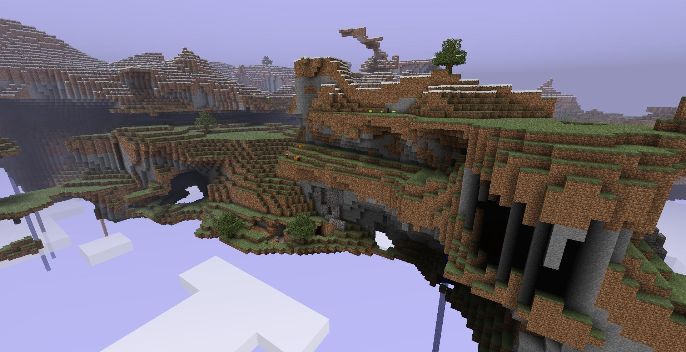

# Dimensions

Dimensions are what Minecraft calls its different worlds that the player can explore, usually via portals.
They often have wildly different terrain, mobs and survival strategies.

## Overworld

The primary world of Minecraft. It is given the numerical Id `0`. It's terrain data is stored in the `world` folder as a result.

The overworld features:

- [Earth-like terrain generation](./generation/overworld)
- Various biomes
- Water oceans
- Progessing time of day
- Changing Weather (Rain, Thunder)
- Can spawn Pigs, Chickens, Cows, Sheep, Squids and Wolves
- Can spawn Zombies, Creepers, Skeletons and Spiders

## Nether

The secondary world of Minecraft, inspired by hell. It is given the numerical Id `-1`. It's terrain data is stored in `world/DIM-1` as a result.

The nether features:

- [Cavern-like terrain generation](./generation/nether)
- Only one biome, "hell"
- Lava oceans
- Can spawn Zombie Pigmen and Ghasts
- Has spontaneously spawning fire
- Water evaporation, meaning it cannot be placed (without exploits)
- Faster lava flow

## Sky

The sky dimension is the unfinished dimension that later became the End. Its numeric ID is `1`. Beta 1.7.3 contains the Sky dimension, biome, and fully working terrain generation code, but there is no way to reach it without client or server modifications.

You can pass `1` to the [Login](/networking/packets/001-login) and [Respawn](/networking/packets/009-respawn) packets to have the client join it.

The sky dimension does not implement saving logic, therefore it does not have its own folder like `DIM1`.

{data-zoomable}

Screenshot of the Sky dimension. Source: [Minecraft Wiki](https://minecraft.wiki/images/Sky_Dimension_1.jpg).

## Further reading:

- [Biomes](./generation/biomes)
