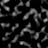

# Biomes

Biomes are regions with differing foliage, terrain etc.

> [!NOTE]
> The seed used throughout all of these examples is `3257840388504953787`, the seed behind [`pack.png`](https://minecraftathome.com/projects/packpng.html).

## Biome List

There exist 13 distinct biomes in Beta 1.7.3. They each have unique properties, mainly if they can show rain particles, if it can snow in them, and what their respective foliage and map colors are.

| Name            | Top Block | Filler Block | Rain | Snow |          Foliage Color          |            Map Color            |
| :-------------- | :-------: | :----------: | :--: | :--: | :-----------------------------: | :-----------------------------: |
| Rainforest      |   Grass   |     Dirt     |  ✅  |  ❌  | <ColorSwatch color="#1FF458" /> | <ColorSwatch color="#08FA36" /> |
| Swampland       |   Grass   |     Dirt     |  ✅  |  ❌  | <ColorSwatch color="#8BAF48" /> | <ColorSwatch color="#07F9B2" /> |
| Seasonal Forest |   Grass   |     Dirt     |  ✅  |  ❌  | <ColorSwatch color="#4EE031" /> | <ColorSwatch color="#9BE023" /> |
| Forest          |   Grass   |     Dirt     |  ✅  |  ❌  | <ColorSwatch color="#4EBA31" /> | <ColorSwatch color="#056621" /> |
| Savanna         |   Grass   |     Dirt     |  ✅  |  ❌  | <ColorSwatch color="#4EE031" /> | <ColorSwatch color="#D9E023" /> |
| Shrubland       |   Grass   |     Dirt     |  ✅  |  ❌  | <ColorSwatch color="#4EE031" /> | <ColorSwatch color="#A1AD20" /> |
| Taiga           |   Grass   |     Dirt     |  ✅  |  ✅  | <ColorSwatch color="#7BB731" /> | <ColorSwatch color="#2EB153" /> |
| Desert          |   Sand    |     Sand     |  ❌  |  ❌  | <ColorSwatch color="#4EE031" /> | <ColorSwatch color="#FA9418" /> |
| Plains          |   Grass   |     Dirt     |  ✅  |  ❌  | <ColorSwatch color="#4EE031" /> | <ColorSwatch color="#FFD910" /> |
| Ice Desert      |   Sand    |     Sand     |  ❌  |  ✅  | <ColorSwatch color="#C4D339" /> | <ColorSwatch color="#FFED93" /> |
| Tundra          |   Grass   |     Dirt     |  ✅  |  ✅  | <ColorSwatch color="#C4D339" /> | <ColorSwatch color="#57EBF9" /> |
| Hell            |   Grass   |     Dirt     |  ❌  |  ❌  | <ColorSwatch color="#4EE031" /> | <ColorSwatch color="#FF0000" /> |
| Sky             |   Grass   |     Dirt     |  ❌  |  ❌  | <ColorSwatch color="#4EE031" /> | <ColorSwatch color="#8080FF" /> |

## Lookup table

A `64x64` lookup table is generated to more quickly calculate the appropriate biome to use.

First we need to apply some of the temperature to the humidity.

$$
h' = h \cdot t
$$

Then we determine the actual biome for that combination of temperature and humidity values, in a range from `0.0` to `1.0` on each axis.

$$
B(t,h)=
\begin{cases}
\text{Tundra} & (h' < 0.2 \land t < 0.5) \lor (t < 0.1)\\

\text{Savanna} & h' < 0.2 \land 0.5 \leq t < 0.95 \\

\text{Desert} & h' < 0.2 \land t \geq 0.95 \\[4pt]

\text{Swampland} & h' > 0.5 \land t < 0.7 \\[4pt]

\text{Taiga} & h' \geq 0.2 \land t < 0.5 \\[4pt]

\text{Shrubland} & 0.5 \leq t < 0.97 \land h' < 0.35 \\

\text{Forest} & 0.5 \leq t < 0.97 \land h' \geq 0.35 \\[4pt]

\text{Plains} & t \geq 0.97 \land h' < 0.45 \\

\text{Seasonal Forest} & t \geq 0.97 \land 0.45 \leq h' < 0.9 \\

\text{Rainforest} & t \geq 0.97 \land h' \geq 0.9
\end{cases}
$$

If mapped to an image, using the foliage/map colors, we get this.

|                                            Foliage Colors                                            |                                          Map Colors                                          |
| :--------------------------------------------------------------------------------------------------: | :------------------------------------------------------------------------------------------: |
|  |  |

Temperature is X, Humidity is Y. Range is from `0` to `63` (or `0.0` to `1.0`) on both axes. [Notch drew this graph back in 2011.](https://minecraft.wiki/w/File:NotchBiomeGraph.png)

## Biome Noise

The function which determines what biome is use in a chunk is relatively simple.
It mainly uses 3 instances of [octaved simplex noise](/technical/noise#simplex-noise).

### Initialization

The climate noise generators each get their own, independent PRNG object, initilizated with its own seed. $W_{seed}$ represents the world seed.

| PRNG   | Seed |
| ----------: | :---- |
| Temperature |  $W_{seed} \cdot 9871$ |
| Humidity    |  $W_{seed} \cdot 39811$ |
| Weirdness   |  $W_{seed} \cdot 543321$ |

Then, the noise generators are initialized.

| Generator   | Octaves |                             Base Scale (x,z) | Octave Frequency Factor |
| ----------: | :-----: | :--------------------------------: | :----: |
| Temperature |   `4`   |             `(0.025, 0.025)` | `1/4` |
| Humidity    |   `4`   |                `(0.05, 0.05)` | `1/3` |
| Weirdness   |   `2`   | `(0.25, 0.25)` | `10/17` |

The base scale and octave frequency factor remain the same throughout biome sampling, meaning that the only value that changes dynamically is the sampled position.

### Sampling

The current Chunk Coordinate, scaled to Block-Space (multiplied by `16`), is passed in, alongside how many values the generator should return (`16x16` for one chunk) and a scaling factor.

Each of these return a `16x16` array of 64-bit floating point numbers, which're that chunks' temperature, humidity and weirdness values.

|                                              Temperature                                               |                                             Humidity                                             |                                              Weirdness                                               |
| :----------------------------------------------------------------------------------------------------: | :----------------------------------------------------------------------------------------------: | :--------------------------------------------------------------------------------------------------: |
|  |  |  |

Temperature, humidity and weirdness values from chunk `-1,-1` to `1,1`. These values are in the `0.0 - 2.0` range.

### Biome map

The final biomes for each column are determined by iterating over the `16x16` array and performing the following actions for each entry.

$$
\begin{aligned}
w &= 1.1 \cdot \,\mathrm{C_{weird}} + 0.5 \\
s &= 0.01 \\
m &= 1.0 - s \\
t &= (0.15 \cdot \,\mathrm{C_{temp}} + 0.7) \cdot m + w \cdot s \\
s &= 0.002 \\
m &= 1.0 - s \\
h &= (0.15 \cdot \,\mathrm{C_{humi}} + 0.5) \cdot m + w \cdot s \\
t &= 1.0 - (1.0 - t)^2 \\
C_{temp} &= \min(1.0,\max(0.0,t)) \\
C_{humi} &= \min(1.0,\max(0.0,h)) \\
\end{aligned}
$$

This gives you the temperature ($C_{temp}$), humidity ($C_{humi}$) and weirdness ($C_{weird}$) values of the chunk. The final biome is then determined by mapping the calculated `0.0` to `1.0` value into the `64x64` biome LUT we calculated before.

Besides being used to determine the biome, temperature is used a few times throughout the overworld generation to determine where snow and ice are placed, so at least it must be kept past this point. 

Both temperature and humidity must be kept for the accurate coloration of foliage.

The final biome map can look something like this over a 3x3 chunk area.

|                                                  Foliage Colors                                                   |                                                Map Colors                                                 |
| :---------------------------------------------------------------------------------------------------------------: | :-------------------------------------------------------------------------------------------------------: |
|  |  |

Due to being modified, the temperature and humidity now also contain different values that were written back to the temperature and humidity arrays.

|                                               Temperature                                               |                                             Humidity                                              |                                              Weirdness                                               |
| :-----------------------------------------------------------------------------------------------------: | :-----------------------------------------------------------------------------------------------: | :--------------------------------------------------------------------------------------------------: |
|  |  |  |

Temperature, humidity and weirdness values from chunks `-1,-1` to `1,1` after being modified by this function. These values are in the `0.0 - 2.0` range. Weirdness is not affected.

This is then passed to the [Overworld Generator](./overworld).

## Further reading

Check out the page for the [Overworld Generator](./overworld).
