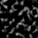

# Overworld Terrain

The generation described in this section will explain how Minecraft Beta 1.7.3 does its Overworld Terrain Generation. A lot of this will be based on educated guesses and the decompilation provided by [RetroMCP](https://github.com/MCPHackers/RetroMCP-Java). Additionally, certain historical bits and pieces will be taken from the [Minecraft Wiki](https://minecraft.wiki/w/World_generation/History#Beta_terrain_generator).

> [!NOTE]
> The seed used throughout all of these comparisons is `3257840388504953787`, the seed behind [`pack.png`](https://minecraftathome.com/projects/packpng.html).

> [!NOTE]
> In any visualizations, the shown chunks range from `-1,-1` to `1,1`. Additionally, up is always towards **Negative Z**, while right is always towards **Positive X**.

## History

The first version to have the Beta-era generator was Alpha 1.2.0, and it was used up until Beta 1.7.3.

However, we can see that the general shape of the terrain remains the same by using the same seed and spawn location in Alpha 1.1.2 (pre-rework), Alpha 1.2.3 (post-rework) and Beta 1.7.3.

| A1.1.2                                          | A1.2.3                                          |
| ----------------------------------------------- | ----------------------------------------------- |
| {data-zoomable} | {data-zoomable} |

This similar pre-1.2.0 generation dates all the way back to Infdev 20100624, before which the world generation looked entirely different.

| Inf20100624                                           | A1.1.2                                          |
| ----------------------------------------------------- | ----------------------------------------------- |
| {data-zoomable} | {data-zoomable} |

Facing the other way reveals some of the more glaring differences between the generators.

| A1.1.2                                               | A1.2.3                                               |
| ---------------------------------------------------- | ---------------------------------------------------- |
| {data-zoomable} | {data-zoomable} |

Between Alpha 1.2.3 and Beta 1.7.3 there only exist minor differences, mainly relating to the feature generation.

| A1.2.3                                               | B1.7.3                                               |
| ---------------------------------------------------- | ---------------------------------------------------- |
| {data-zoomable} | {data-zoomable} |

## Biomes

To find out more about what biomes exist and how they're defined, check out [the biomes page](biomes)./

This process uses 3 octaved [Simplex Noise](/technical/noise#simplex-noise) generators called Temperature, Humidity and Weirdness. This process is described [here](biomes#biome-noise).

|                                               Temperature                                               |                                             Humidity                                              |                                              Weirdness                                               |
| :-----------------------------------------------------------------------------------------------------: | :-----------------------------------------------------------------------------------------------: | :--------------------------------------------------------------------------------------------------: |
|  |  |  |

<sub>Temperature, humidity and weirdness values after being modified by this function. These values are in the `0.0 - 2.0` range.</sub>

With this a `16x16` Biome Array is generated, where any block column can contain any of the 13 Biomes.

|                                                  Foliage Colors                                                   |                                                Map Colors                                                 |
| :---------------------------------------------------------------------------------------------------------------: | :-------------------------------------------------------------------------------------------------------: |
|  |  |

<sub>Biomes colored as per the [biomes](biomes#biome-list) page.</sub>

## Terrain Shape

### Noise Octaves

The Beta 1.7.3 terrain generator has a shared [Pseudorandom Number Generator](/technical/javaFeatures#random), alongside 8 [Octaved Perlin Noise Generators](/technical/noise), 7 of which are relevant for world generation.

| Generator          | Octaves |                                               Scale |
| :----------------- | ------- | --------------------------------------------------: |
| Low Noise          | `16`    |                       `(684.412, 684.412, 684.412)` |
| High Noise         | `16`    |                       `(684.412, 684.412, 684.412)` |
| Selector Noise     | `8`     | `(684.412 / 80.0, 684.412 / 160.0, 684.412 / 80.0)` |
| Continentalness    | `10`    |                                    `(1.121, 1.121)` |
| Depth Noise        | `16`    |                                    `(200.0, 200.0)` |
| Tree Density Noise | `8`     |                                          (variable) |

::: tip MISSING
Where does `684.412` come from?? Find a source on this!

The best theory we have right now is

$$
684.412 = 4 \times 2^{15} \times 0.005221649073064327
$$

Where $4$ is the horizontal spacing between blocks (due to the $\frac{1}{4}$ scale), $2^{15}$ is the frequency multiplier of the 16th octave, and $0.005221649073064327$ is the base noise frequency.
:::

|                                    Low                                     |                                     High                                     |                                       Selector                                       |                                            Continental                                             |                                     Depth                                      |
| :------------------------------------------------------------------------: | :--------------------------------------------------------------------------: | :----------------------------------------------------------------------------------: | :------------------------------------------------------------------------------------------------: | :----------------------------------------------------------------------------: |
|  |  |  |  |  |

<sub>Colors adjusted be more visible.</sub>

Continentalness and depth are 2D, while low, high and selector noise are 3D. As a result, only the lowest slice of each is shown. Tree density is 2D as well, but only used during the [population stage](population#trees) for trees.

### Terrain Noise

The terrain noise is for calculating the density of the terrain throughout the chunk.

#### Constants

Before we get started, we must discuss some of the relevant constants for this section.

Firstly, the maximum x, y and z values. Our noises are sampled at `1/4` resolution, but to get the cross-boundary overlap, we sample it at `1/4 + 1`

$$
X_{\max},Z_{\max} = \frac{ChunkWidth}{4} + 1
$$

$$
Y_{\max} = \frac{ChunkHeight}{4} + 1
$$

For the default chunk size of `16x128x16`, this results in `5` for the horizontal axis and `17` for the vertical one.

$Y_{water}$ is the global water level, which is `64` by default.

$C_{humi}$ and $C_{temp}$ are the humidity and temperature values that were generated in the Biome generation step at the current X,Z coordinate. Same goes for $N_{cont}$ and $N_{depth}$, which are the continentalness and depth values of the current X,Z coordinate.

#### 2D Noises

The following logic is iterated over along the X and Z axes. It's responsible for sampling the 2D noises, normalizing and combining them.

1. Put temperature and humditiy together

$$
h = 1 - (1 - {C_{humi}} \cdot {C_{temp}})^4
$$

2. Normalize the contientalness values, apply the new humidity value, then clamp into the range `0.0` to `1.0`, then offset by `0.5`.

$$
{C_{norm}} = 0.5+
\operatorname{clamp}
\left(
\frac{N_{cont}+256}{512}\cdot
h,
0,1
\right)
$$

2. Calculate the depth values

$$
d_0 = \frac{N_{depth}}{8000}
$$

$$
d_1 =
\begin{cases}
-0.3 \cdot d_0 & d_0<0\\
d_0 & d_0\geq0
\end{cases}
$$

$$
d_2=3 \cdot d_1 - 2
$$

$$
d_3 =
\begin{cases}
\frac{\operatorname{clamp}(d_2,-1,0)}{5.6}
& d_2<0\\[6pt]
\frac{\min(d_2,1)}{8}
& d_2\geq0
\end{cases}
$$

3. Force continentalness to `0.0` if depth is negative.

$$
C_{norm} =
\begin{cases}
0 & d_2<0\\
C_{norm} & d_2\geq0
\end{cases}
$$

This leaves the continentalness in a range of `0.5` to `1.5`, unless a negative depth forces it to `0.0`. This is the bit of math that prevents monoliths from happening.

4. Calculate the base terrain height

$$
Y_{base}=\frac{Y_{\max}}{2}+\frac{Y_{\max}}{4}d_3
$$

#### 3D Noises

After this follow the 3D noises. These are iterated over bottom to top, inside of the above X,Z ordered iteration. $y$ obviously represents the current vertical coordinate.
$N_{low}$, $N_{high}$ and $N_{selector}$ are our current Low, High and Selector noise samples. $\rho$ represents our final terrain density.

1. Combine our previously calculated values

$$
d_0 = \frac{12(y-Y_{base})}{C_{norm}}
$$

2. If they turn out negative, multiply by `4.0`

$$
d =
\begin{cases}
4 \cdot d_0 & d_0<0\\
d_0 & d_0\geq0
\end{cases}
$$

3. Normalize our low, high and selector noise samples

$$
l = \frac{N_{low}}{512}
$$

$$
h = \frac{N_{high}}{512}
$$

$$
s = \frac{N_{selector} / 10 + 1}{2}
$$

4. Linearly interpolate (lerp) between the low and high noise in the places where the selector noise transitions between `0.0` and `1.0`

$$
t =
\begin{cases}
l & s<0\\
h & s>1\\
l+(h-l) \cdot s & 0\leq s\leq1
\end{cases}
$$

5. Subtract the density offset

$$
\rho=t-d
$$

6. Fade the terrain towards the world ceiling

$$
\rho(y)=
\begin{cases}
\rho & y\leq Y_{\max}-4\\[4pt]
\rho(1-f)-10 \cdot f & y>Y_{\max}-4
\end{cases}
$$

The result of this is placed into our `5x17x5` array of 64-bit floating point values.

### Interpolation

Minecraft uses [Trillinear interpolation](https://en.wikipedia.org/wiki/Trilinear_interpolation) to interpolate between the generated density values, to scale them up to the final `16x128x16` chunk size.

The placed block is determined as follows.

1. Any block below the water level ($Y_{water}$), is water or ice. It's only ice if the temperature ($C_{temp}$) of the column is less than `0.5`
2. If the current interpolated density sample ($\rho_i$) is greater than `0.0`, stone will be placed there
3. All other blocks default to being air

|                                            Terrain                                            |                                                   Terrain (water)                                                   |
| :-------------------------------------------------------------------------------------------: | :-----------------------------------------------------------------------------------------------------------------: |
|  |  |

<sub>Highest stone blocks. Color values have been tweaked to be more readable.
Blocks at or below water level are marked in blue.</sub>

## Biome Blocks

::: tip MISSING
TODO: The following still contains code!
:::

After the terrain shape has been generated, the chunk is transformed further by the Sand, Gravel and Stone Perlin Noise Generators.

| Generator                    | Octaves |                Scale |
| :--------------------------- | ------- | -------------------: |
| Sand & Gravel Noise (Sand)   | `4`     |  `(1/32, 1/32, 1.0)` |
| Sand & Gravel Noise (Gravel) | `4`     |  `(1/32, 1.0, 1/32)` |
| Stone Noise                  | `4`     | `(1/16, 1/16, 1/16)` |

|                                              Sand                                              |                                               Gravel                                               |                                              Stone                                               |
| :--------------------------------------------------------------------------------------------: | :------------------------------------------------------------------------------------------------: | :----------------------------------------------------------------------------------------------: |
|  |  |  |

<sub>Sand, Gravel and Stone noise. Color values have been tweaked to be more readable.</sub>

#### X-Z Logic

The chunk is now iterated over in x-z order.

1. The biome for the specified column is read ($C_{biome}$)
2. Its checked if sand is possible to be placed here ($A_{sand}$)
3. Its checked if gravel is possible to be placed here ($A_{gravel}$)
4. An integer is generated for if stone can be placed here ($A_{stone}$, $D_{stone}$)
5. The biomes appropriate top ($B_{top}$) and filler ($B_{filler}$) block is chosen (e.g. Grass and Dirt)

#### Y Logic

For this the current block column is iterated over from top to bottom, from `127` down to `0`. $B_{block}$ is the current block value.

1. Check if bedrock can be placed. This utilizes a number from the Java PRNG ($R$) between `0` and `4`.

$$
y\leq R
$$

If bedrock gets placed, we just continue on to the next $y$ value.

2. If the current block ($B_{block}$) is air, set $D_{stone}$ to `-1.0`, and continue onto the next $y$ value.

$$
D_{stone} =
\begin{cases}
-1 & B_{block} = Air\\
D_{stone} & B_{block} \neq Air \\
\end{cases}
$$

3. If the current block ($B_{block}$) is not stone, continue onto the next $y$ value.

4. The following (to be mathified)

```cpp
if (d_stone == -1) {
  if (a_stone <= 0) {
    b_top = Air;
    b_filler = Stone;
  } else if (y >= y_water - 4 && y <= y_water + 1) {
    // If we're close to the water level, apply gravel and sand
    b_top = GetTopBlock(c_biome);
    b_fillter = GetFillerBlock(c_biome);
    if (a_gravel) {
      b_top = Air;
      b_filler = Gravel;
    }
    if (a_sand) {
      b_top = Sand;
      b_filler = Sand;
    }
  }
  // Add water if we're below water level
  if (y < y_water && b_top == Air)
    b_top = Water;
  d_stone = a_stone;
  if (y >= y_water - 1)
    SetBlock(b_top, position);
  else
    SetBlock(b_filler, position);
} else if (d_stone > 0) {
  --d_stone;
  SetBlock(b_filler, position);
  if (d_stone == 0 && b_filler == Sand) {
    d_stone = rand.nextInt(4);
    f_filler = Sandstone;
  }
}
```

## Caves

See the [cave generation wiki page](./caves)

After this, the lighting is updated and the heightmap is generated.

## Heightmap

The initial heightmap generation boils down to iterating through every `xz` coordinate, from the top to the bottom, and stopping if any block with an Opacity that isn't `0` is run into. Additionally, it keeps track of the lowest block height it has encountered up to that point.

## Population

Continue onto the [population page](population) to find out more.

## Further reading

- [Java Edition Far Lands/Infdev 20100327 to Beta 1.7.3](https://minecraft.wiki/w/Java_Edition_Far_Lands/Infdev_20100327_to_Beta_1.7.3)
- [Nether](./nether#generation)
- [Beta 1.8 Generation](https://github.com/PhoenixVX/golden-age-wiki/blob/main/minecraft/genlayer/sequence/b18.md)
- [Release 1.0 Generation](https://github.com/PhoenixVX/golden-age-wiki/blob/main/minecraft/genlayer/sequence/r100.md)
- [Release 1.1 Generation](https://github.com/PhoenixVX/golden-age-wiki/blob/main/minecraft/genlayer/sequence/r11.md)
- [Release 1.2 Generation](https://github.com/PhoenixVX/golden-age-wiki/blob/main/minecraft/genlayer/sequence/r12.md)
